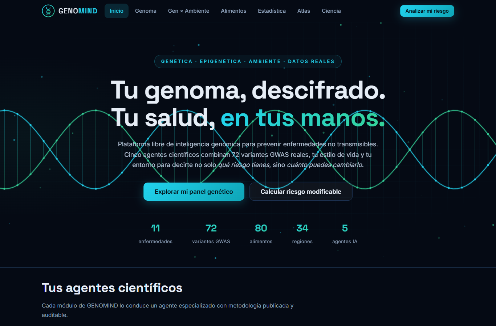
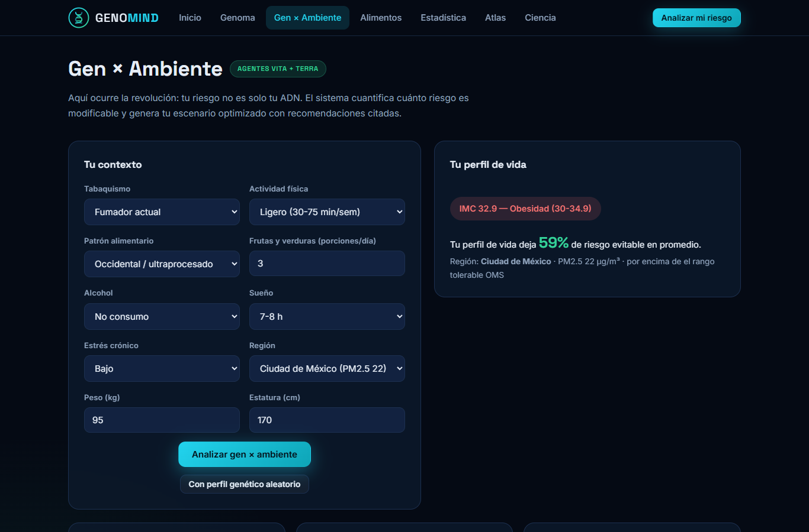
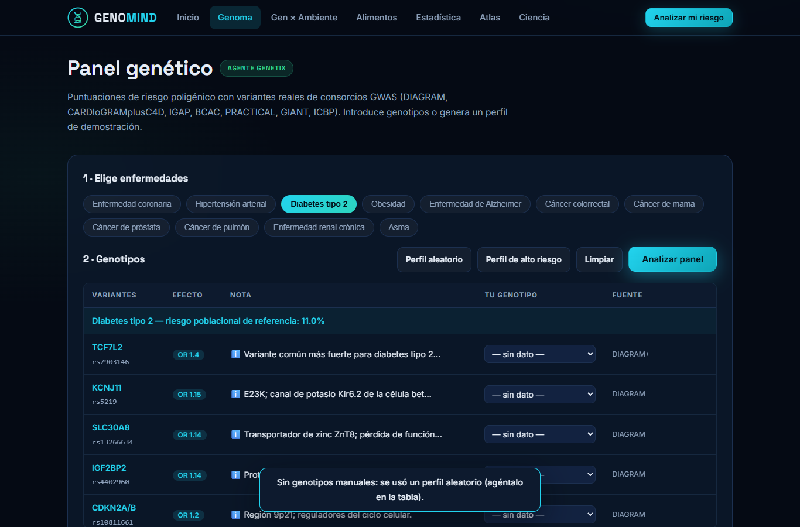
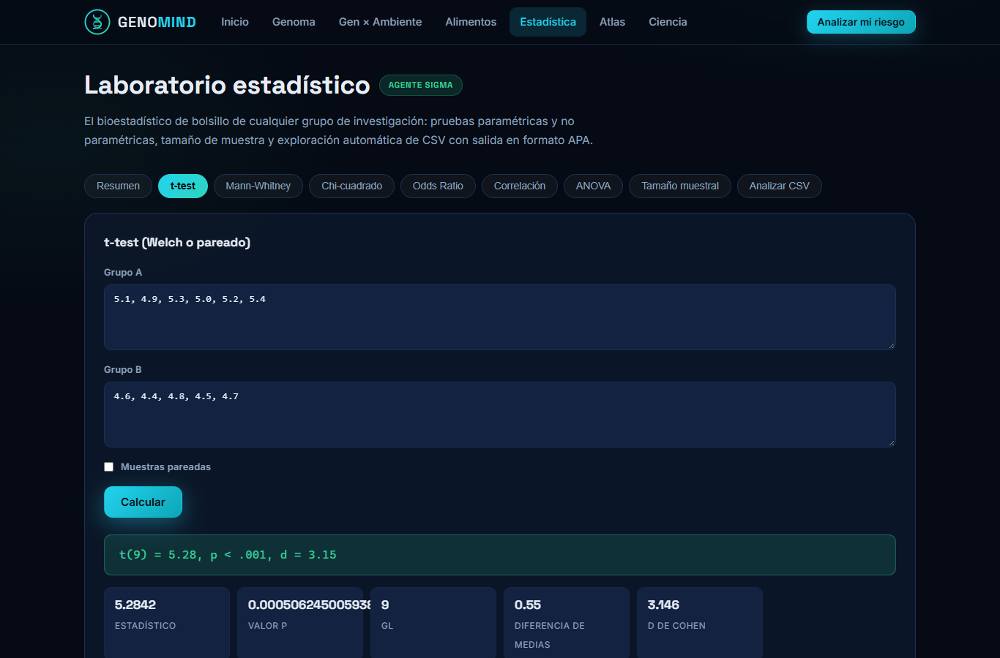

<div align="center">

# GENOMIND

### Inteligencia Genómica Abierta para la Prevención de Enfermedades No Transmisibles

**Tu genoma, descifrado. Tu salud, en tus manos.**

[](https://github.com/eduerking-crypto/proyecto-1/actions/workflows/ci.yml)
[](LICENSE)
[](https://www.python.org)
[](backend/tests)

Una plataforma libre que combina **genética real (72 variantes GWAS)**, **ambiente**, **dieta** y **estilo de vida** para cuantificar el riesgo de 11 enfermedades no transmisibles — y lo más importante: **cuánto de ese riesgo es evitable**.

*Diseñada para funcionar en el equipo más modesto de la universidad pública más subfinanciada del planeta.*

</div>

---

## ¿Por qué existe GENOMIND?

| El problema | El dato |
|---|---|
| Las ENT son la primera causa de muerte | 41 millones/año, 74% de las muertes globales (OMS) |
| Castiga sobre todo a los países pobres | 77% de las muertes por ENT ocurren en países de ingresos bajos y medios |
| La genómica tiene sesgo ancestral | >86% de los participantes de GWAS son de ascendencia europea |
| La medicina de precisión es inaccesible | Un panel genético clínico cuesta más que el ingreso anual de millones de familias |

**GENOMIND responde con ciencia abierta**: datos GWAS publicados y citados, metodología transparente, código MIT, sin nubes caras, instalable en 60 segundos y con una API que cualquier investigador puede auditar y ampliar.

## Los 5 agentes científicos

| Agente | Rol | Qué hace |
|---|---|---|
| **GENETIX** | Genetista molecular | Puntuaciones de riesgo poligénico (PRS) con 72 variantes reales de DIAGRAM, CARDIoGRAMplusC4D, IGAP, BCAC, PRACTICAL, GIANT e ICBP |
| **SIGMA** | Bioestadístico | t-test (Welch/pareado), Mann-Whitney, χ² con Fisher automático, OR con IC95, correlaciones, ANOVA, potencia y análisis automático de CSV — todo con salida APA |
| **VITA** | Medicina preventiva | Motor gen × ambiente con multiplicadores citados (DPP, PREDIMED, INTERHEART) y detección de interacciones gen-ambiente documentadas |
| **TERRA** | Salud ambiental | Atlas de 34 regiones: PM2.5, espacios verdes, caminabilidad, acceso a salud y mortalidad por ENT |
| **NUTRIX** | Nutrición social | 80 alimentos con IG, sodio, costo y huella hídrica + la **cesta vital**: la combinación más barata que cubre 50 g de proteína y 25 g de fibra al día |

## Funciones

- **Panel genético** — edita genotipos SNP a SNP o genera perfiles simulados bajo equilibrio de Hardy-Weinberg; PRS normalizada con percentil poblacional
- **Gen × Ambiente** — riesgo combinado vs **escenario optimizado**: ve el riesgo evitable en puntos porcentuales por enfermedad, con recomendaciones priorizadas y su fuente científica
- **Interacciones gen-ambiente reales** — FTO × actividad física, APOE ε4 × ejercicio, CHRNA5 × tabaquismo, TCF7L2 × estilo de vida, 9p21 × tabaquismo, APOL1 y equidad ancestral
- **Comparador de alimentos** — hasta 4 alimentos lado a lado, mejor valor por nutriente, puntuación de salud transparente
- **Laboratorio estadístico** — 9 herramientas con formato APA listo para pegar en un manuscrito; calculadora de tamaño muestral para investigadores sin acceso a SPSS
- **Atlas ambiental** — dispersión PM2.5 vs esperanza de vida, multiplicadores de riesgo por calidad del aire (Guía OMS 2021)
- **PWA** — instalable, funciona offline tras la primera visita, animaciones que se desactivan con `prefers-reduced-motion`
- **Perfiles** — guarda y recupera análisis en SQLite

## Capturas

| Inicio | Gen × Ambiente |
|---|---|
|  |  |
| **Panel genético** | **Estadística** |
|  |  |

## Instalación (60 segundos)

```bash
git clone https://github.com/eduerking-crypto/proyecto-1.git
cd proyecto-1
pip install -r backend/requirements.txt
python run.py
```

Abre **http://localhost:8000** — la interfaz, la API y la base de datos SQLite (auto-sembrada) arrancan juntos.

### Docker

```bash
docker compose up --build
```

### Solo la API

```bash
cd backend
uvicorn main:app --reload
# Docs interactivas: http://localhost:8000/docs
```

## Arquitectura

```
proyecto-1/
├── run.py                    # Lanzador único
├── backend/                  # FastAPI + SQLite
│   ├── main.py               # API REST (25+ endpoints)
│   ├── database.py           # Esquema + seed automático
│   ├── agents/               # Los 5 agentes científicos
│   │   ├── genetic_agent.py      # GENETIX: PRS Hardy-Weinberg
│   │   ├── lifestyle_agent.py    # VITA: gen × ambiente
│   │   ├── nutrition_agent.py    # NUTRIX: comparador + cesta vital
│   │   └── statistical_agent.py # SIGMA: motor estadístico
│   ├── data/                 # Datos JSON auditables y citables
│   │   ├── snps.json         # 72 variantes GWAS (rsid, gen, OR, frecuencia)
│   │   ├── diseases.json     # 11 ENT con riesgo de referencia y fuente
│   │   ├── foods.json        # 80 alimentos (IG, sodio, costo, agua)
│   │   ├── regions.json      # 34 regiones (PM2.5, esperanza de vida)
│   │   └── lifestyle.json    # Multiplicadores con evidencia + interacciones
│   └── tests/                # 58 tests: matemática PRS, estadística, API
├── frontend/                 # SPA sin dependencias (HTML+CSS+JS)
│   ├── index.html            # 7 vistas
│   ├── css/styles.css        # Design system accesible
│   ├── js/                   # api, gráficos SVG propios, app
│   └── sw.js                 # Service worker offline
└── docs/screenshots/         # Verificación Playwright
```

**Decisiones de diseño**: frontend vanilla (0 KB de frameworks, corre en cualquier navegador), gráficos SVG hechos a mano (sin CDN), SQLite (portable, sin servidor de BD), scipy/numpy como única dependencia científica. Cada dato del catálogo tiene su fuente en el propio JSON.

## API (extracto)

```http
GET  /api/health                          # estado + conteos
GET  /api/diseases                        # 11 ENT con riesgo de referencia
GET  /api/diseases/T2D/snps               # panel genético de una enfermedad
POST /api/analysis/polygenic/batch        # PRS multi-enfermedad
POST /api/analysis/gene-environment       # riesgo combinado + evitable
POST /api/nutrition/basket                # cesta vital optimizada
POST /api/stats/ttest | chisq | or | anova | power | dataset | …
```

Ejemplo:

```bash
curl -X POST http://localhost:8000/api/analysis/gene-environment \
  -H "Content-Type: application/json" \
  -d '{"genotypes":{"rs16969968":"AA"},"lifestyle":{"smoking":"fumador","activity":"sedentario","diet":"occidental","servings_fv":1,"sleep":"corto","stress":"alto","weight_kg":95,"height_cm":170},"region_id":"IN-DEL"}'
```

## Metodología (resumen)

**PRS**: `RR = exp(Σ ln(ORᵢ)·dosageᵢ − E[PRS])` con esperanza y varianza bajo equilibrio de Hardy-Weinberg; percentil vía CDF normal.

**Gen × ambiente**: `RR_combinado = RR_genético × Π m_factor` — modelo multiplicativo simplificado, documentado como tal. El escenario optimizado fija los factores modificables a su mejor valor con evidencia y cuantifica el **riesgo evitable**.

**Limitaciones honestas** (sección Ciencia en la app): sesgo ancestral de los GWAS, ORs redondeados, modelo educativo que no sustituye consejería genética. La ciencia seria declara sus supuestos.

## Tests y calidad

```bash
cd backend && python -m pytest tests -q   # 58 passed
```

Cobertura: matemática PRS (dosage, HWE, cap de RR, simuladores), estadística contra valores de referencia de scipy, integración API (análisis completo gen × ambiente, CRUD de perfiles) y verificación E2E con Playwright (17 checks de UI + 0 errores de consola).

## Contribuir

¿Eres genetista, nutricionista, bioestadístico o epidemiólogo de un país de ingresos bajos o medios? **Este proyecto te necesita**:

1. Variantes multi-ancestría con ORs de poblaciones subrepresentadas
2. Alimentos locales (¡conoces los tuyos!)
3. Datos regionales de tu ciudad
4. Traducciones (la UI es español-first; el mundo tiene 7000 idiomas)

Los datos viven en JSON auditables en `backend/data/` — un pull request con mejoras citadas es una contribución científica.

## Aviso legal

Herramienta **educativa y de investigación**. No diagnostica, no sustituye consejería genética ni consejo médico. Los datos GWAS provienen de literatura pública citada en la sección Ciencia de la aplicación. Ver [DISCLAIMER](#) en la sección Ciencia.

## Licencia

[MIT](LICENSE) — cópialo, enséñalo, llévalo a tu comunidad.

---

<div align="center">
<sub>Hecho con datos abiertos, para los que la ciencia olvidó.</sub>
</div>
